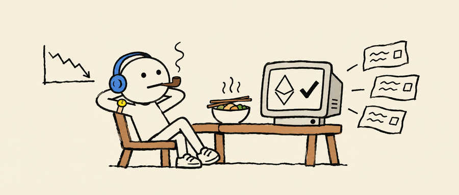

# AI 时代需要低成本的验证方式

周末了，那就吃点好的，好好睡觉。既然保护不了价格，那就保护一下自己的身心健康吧。

价格下跌的时候，人很难对一堆路线图和升级名字保持耐心，经历过几轮叙事以后，对宏大蓝图保持怀疑，也是很正常的。

对于区块链和以太坊来说，低成本的验证是一条贯穿以太坊发展历程的主线。其实对于以太坊来说，无论是作为世界计算机还是作为世界的结算层，本质上就还是在做这件事情。

只要以太坊还能把这件事往前推，我就认为，以太坊还是那个以太坊。

其实在 BTC 和以太坊出现之后，我们信任一个事情都是有信任假设的，比如对某个人的信任，对一个组织或者国家主权的信任。

当然这个信任也不是凭空产生的，也会有一个很长的积累，但由于债务或者其他的各种原因，这种信任可能会在某个时间点会破裂。

而区块链出现之后，我们可以直接信任代码和数学，可以说，这是人类第一次在不需要任何信任假设的前提下来信任一件事情。

但当然，对于区块链来说，没有这个信任假设的前提是你可以运行自己的节点。而目前对于所有的区块链来说，几乎只有以太坊和 BTC 还在做这个事情。

BTC 从诞生之后，几乎就没有出现过什么变化，而以太坊则在持续更新中，这些更新都在尽量维持一个底线，让任何一个人都可以把节点运行起来。

但在大规模采用面前，要做到这点其实非常困难，因为数据的量级与单节点的存储有很大的冲突，所以以太坊还在尝试数据裁剪，无状态化等等方式，这些最终都是为了保证验证不需要建立在任何信任假设，只需要建立在密码学的保证之上。

或许随着以太坊的用户量越来越大，想要完全保护这个底线很困难，但至少让需要的信任假设尽可能的少。

在 AI 大规模爆发之后，生成变得越来越简单，但是验证却变得很贵，我们信任 AI 的内容就需要有很大的信任假设。我们不只需要对 AI 产生的内容有信任假设，还需要对使用 AI 的人有信任假设。

但在人的生产力远远不如 AI 的情况下，这种方式太低效了，不仅不能让 AI 的能力发挥出来，还会把人搞得很累。

区块链是有可能降低 AI 验证成本的方式。

比如 ERC-8004 尝试处理的，就是 Agent 跨组织协作时的身份、反馈和第三方验证记录。

它不能保证一个注册过的 Agent 诚实，也不能消灭刷好评，但它给不同服务读取和组织这些记录提供了一套低成本的验证方式，至于对结果是否接受，还是需要看用户自己。

支付也是一样。x402 尝试让软件按请求付款，以太坊生态网络可以参与结算，让 Agent 之间的支付变得很简单，验证成本足够低。

当然，这里的验证是一种很宽泛的验证，区块链并不能代表人做出正确的决策。它只能证明AI 在某个时刻做过什么，并且可以保证人类有审计的能力。

但能做到这点就很重要，因为人可以从无穷的细节中解放出来，不用去和 AI 比生产力，只需要直接做最终的决策。

以太坊不需要解决所有问题。它需要继续把自己擅长的那部分做好，始终保持低成本验证，其他的交给时间。
