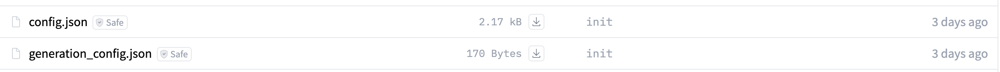
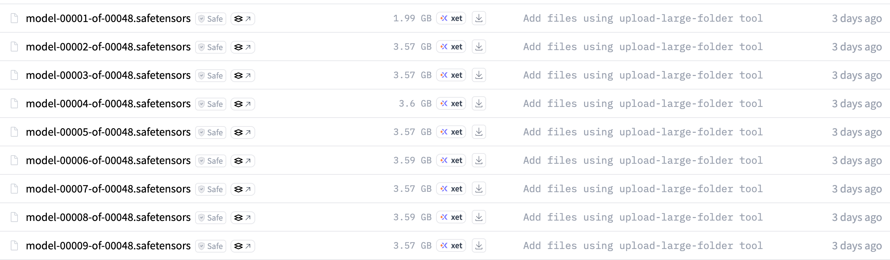
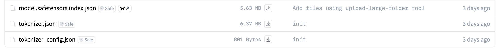
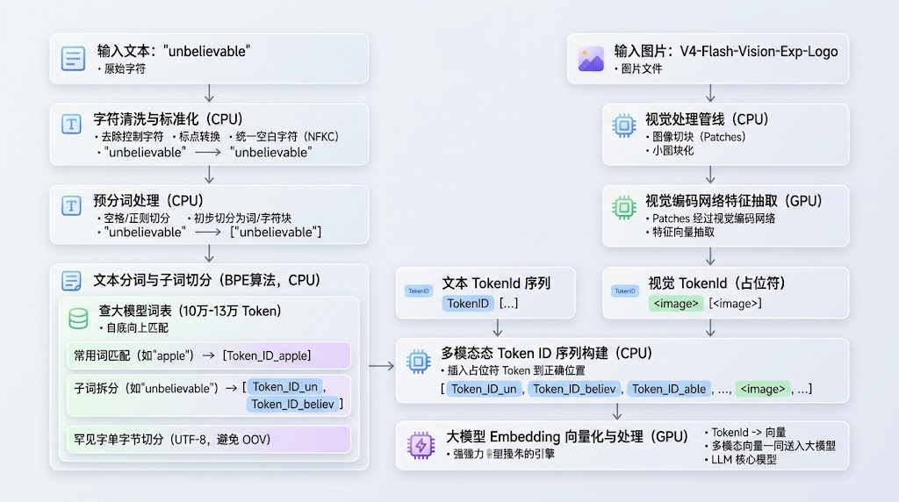
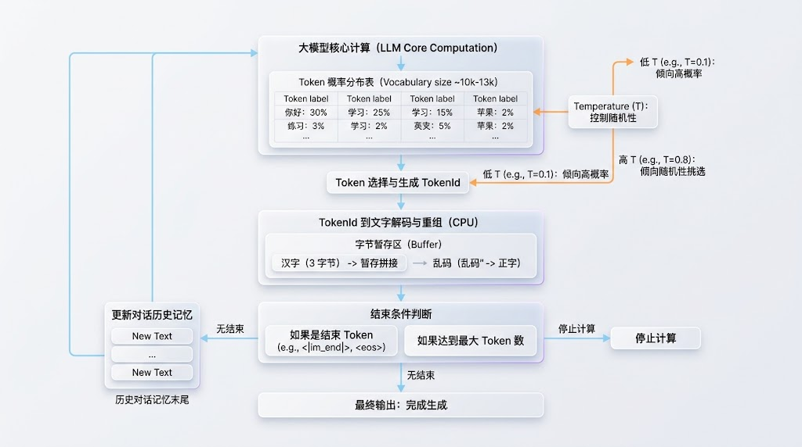
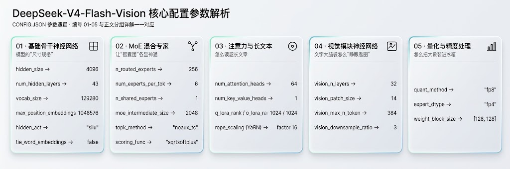

# 读懂大模型 ｜ 别怕，大模型的本质就是一个函数

每次一个大模型发布时，一般会说这个模型有多少参数，比如 2.4T。以及当前大模型在各个评测记录下的跑分是多少。

跑分的结果比较好懂，一般来说分数是越高越好，然后和已经在用的模型做个对比，新模型大概什么水平就有数了。

如果用最简单，最抽象的方式理解大模型，可以把代码理解为一个可以被调用的函数，函数的参数量就是发布的参数，比如 2.4T，也就是说，它除了参数量更多一点之外，其他方面和调用一个普通的函数也没什么区别。

## 初始大模型结构

以 DeepSeek 开源的 V4-Flash-Vision-Exp 为例，先看一下一个大模型的整理结构。

首先是这个两个配置文件，config.json 是基础的配置文件，定义了模型的层数、隐藏层维度、注意力头数、专家混合（MoE）配置及视觉编码模块结构等超参数，这些概念在后续会说到。

generation_config.json 定义了文本生成默认配置文件。包含推理时默认的采样参数，例如 `temperature`、`top_p`、最大生成长度以及停止词标记等。

模型的权重分片文件。模型采用 safetensors 格式存储，V4-Flash-Vision-Exp 总大小约为 168 GB，被切分为 48 个分片以方便传输与分块加载。这些权重分片是大模型的核心，每个文件内部存储的都是模型经过海量数据训练后收敛的**多维数值矩阵**。或者换句话说，**大模型本质上是一个做矩阵运算的函数**。

model.safetensors.index.json 是模型权重索引文件。记录了模型中每一个层具体映射在 48 个 `.safetensors` 分片中的哪一个位置。

tokenizer.json 中是完整的分词器配置文件。包含模型词表、Token ID 映射、BPE/SentencePiece 词元切分规则及规范化流程。只认识 token。token 是它的最小单位，一个英文单词可能占一个 token，也可能拆成两三个，一个汉字通常占一两个。对于输入，所有的文字都会分词，然后映射为一个 token，而 token 进入到模型之后，会被 Embedding 成为一个向量。V4-Flash-Vision-Exp 词表中有 129280 个 token。

对于大模型的输出，其实就是是一个向量，然后经过一系列操作（后面详细展开）映射为一个 token，然后通过词表输出给用户。

最后 tokenizer_config.json 中是分词器的行为参数设置。包含特殊 Token（如起始符 `<s>`、结束符 `</s>`、填充符 `<pad>` 等）的定义与处理逻辑。

是的，上面这些就是一个大模型的全部了，一个函数主体（权重分片文件），一个初始配置文件（config.json），以及一个输入输出的映射表（tokenizer.json）。

大模型运行起来之后，就是不断地接受输入，通过词表把输入映射为大模型能处理的向量，然后产生输出，再通过词表映射为具体的文字。

## 输入输出处理流程

因为大模型本身无法识别文字，所以输入进入大模型之前以及大模型输出都需要处理。输入就是把文本处理向量，输出就是把向量处理为文本。

### 输入处理及 Embedding

输入在进入大模型之前，需要先经过分词处理为 TokenId，然后再经过 Embedding 为大模型可以处理的向量。

文本分词处理这个过程不需要大模型参与，直接通过机器的 CPU 处理就可以。

首先需要对原始字符做清洗与标准化（Normalization），统一编码格式。常见操作包括去除冗余不可见控制字符、转换全角半角标点、统一空白字符（或 Unicode 标准化如 NFKC）等，保证输入的一致性。

然后就开始对这些词进行预分词处理（Pre-tokenization），将连续的文本初步切分为较粗的词或字符块。通常利用正则表达式或空格规则，将英文按单词和标点拆开，将中文字符单独分割，或者把空格替换为特定的占位符（如 `_` 或 Byte-level 字符）。

预处理完成之后，子词切分算法，比如贪心匹配切分分词器会自底向上查表，常见单词或常用汉字作为一个整体：如 `"apple"` → 1 个 Token；`"你好"` → 1 或 2 个 Token。罕见词或生僻词被拆分成更小的词根或子词：如 `"unbelievable"` → `["un", "believ", "able"]`。完全未见过的生僻字符、表情符号或乱码：回退到 UTF-8 单字节序列切分，彻底避免了未知字符（Out-of-Vocabulary / OOV）的问题。

这里说的表就是上面大模型的词表。在模型训练前，算法从数万个基础单字节（Bytes）出发，不断统计海量语料中相邻字符/字节的出现频次，将最高频共现的组合合并为一个新 Token，直到词表达到设定容量（通常在 10 万到 13 万个词元左右）。

目前绝大多数现代开源大模型（包括 DeepSeek、LLaMA 等）都采用 **BPE（Byte-Pair Encoding，字节对编码）** 算法。

对于 V4-Flash-Vision-Exp 这类多模态的大模型，文本按上述规则切成一串文本 Token ID。图片则通过视觉处理管线切成小图块（Patches），经过视觉编码网络抽取特征后，以**占位符 Token**（如 `<image>`）的形式插入到文本 Token 序列对应的位置中，一同送入大模型。

## MoE 架构

如果大模型想要越来越聪明，那么参数量就必须越来越大，但随着大模型参数量越来越多，对运行时的算力要求也越来越大。而 MoE 架构做的事情就是将参数量与计算成本解耦了。

原来的模型，输入的 Token 无论是什么类型，都必须经过模型的全部参数计算。而 MoE（Mixture of Experts，混合专家架构）做的事情，是将这个原本庞大、统一的大模型中拆解为许多个并行的子网络（称为专家，Experts），并在前端增加一个智能分发中心（称为门控路由器，Router）。

但输入进入到网络之后，会先对这个输入进行分析，然后做一个轻量级计算，匹配这个输入与所以专家的匹配程度。然后取匹配程度前几名的专家进行实际的计算。这里是指每个专家会对这些 Token 进行独立的推理计算。

然后再对所有专家的计算结果进行加权汇总，得到最后的结果。

### 输出处理

输入在进入大模型之后，就会经过一系列的计算，每次会产生一个 Token 的概率分布表，对应的是词表中每个 token 的概率。

对，这里说明了大模型的最关键的一点，它的产出不是确定的，而是概率性的，最后大模型会从这个概率表中选择哪个 Token 是由一个叫 Temperature 的参数来控制。

如果 Temperature 设置的很低，那么就会选概率高的 Token，如果 Temperature 设置的高，那么就会在概率前几名的 Token 里面随机挑选。

选定之后，就是产出一个 TokenId。同样也会从词表中找到对应的实际文字，如果这个词是残缺的字节（比如一个中文汉字在 UTF-8 编码下占 3 个字节，当前只吐出了 1 个字节），解码器会先把它放进暂存区，等下一个 Token 出来拼齐成一个完整的文字再输出，避免前端显示乱码。

拿到这个词后，系统会判断这个 tokenId 是不是结束标记（如 `<|im_end|>`、`<eos>`），或者达到了你限制的最大字数，然后就停止计算。

如果没有结束，那么就会把这个刚刚生成出来的新词，顺手塞回到模型的历史对话记忆末尾，紧接着去算下一个词（这就是所谓的自回归文本接龙）。

## 参数解析

config.json 中包含了大模型的核心参数，对于这些参数，并不需要死记硬背，有大概的了解就可以，后续如果需要了解的时候查一下就可以。

每张卡只列参数名和值，含义按编号 01-05 看下面的分组详解。

### 01. 基础骨干网络参数

- `vocab_size: 129280`（词表大小）：模型掌握的“汉字/单词总字典”有多厚。
- `hidden_size: 4096`（隐藏层维度）模型思考一个词时，用了多少个“特征维度”来描述它。
- `num_hidden_layers: 43`（网络层数）：信息要穿过多少道思考关卡。
- `max_position_embeddings: 1048576`（100 万上下文）：模型的工作记忆容量。100 万 Token 大约相当于几本厚重的新华字典或几十万行工程代码。它的脑子依然能记住从第 1 行到第 100 万行的前后位置关系，不会读了后面忘了前面。但是在使用中不会真的把它用满，用的越满模型的响应质量越差。

### 02. MoE 混合专家参数

- `n_routed_experts: 256` vs `num_experts_per_tok: 6`（256 选 6）：大模型中内置了 256 位不同领域的专家，但每遇到一个词，只激活叫 6 个专家计算。
    - 如果你让 256 个专家每次都参与计算，机房电费和计算时间吃不消，但如果遇到写 Python 代码的词，只叫懂代码的 6 个专家。遇到算数，叫数学的 6 个专家。这样既拥有了 256 人的超大知识库，又只花了 6 个专家的成本。
- `n_shared_experts: 1`（1 个常驻共享专家）：专门留 1 个常驻专家，每一个词都必须经过他。像“的、了、是”、标点符号或基本语法常识，没必要让 256 个专家重复去计算。这个常驻专家把所有通用的基础杂活全包了，剩下的 256 个专家就可以专注各自的硬核专业。
- `topk_method: "noaux_tc"`（无辅助损失的选人机制）：防止“明星专家累死、普通专家摸鱼”的排班策略。有些专家可能初始表现好，派单员就天天给他派活，导致其他专家被冷落退化。这个机制通过在后台悄悄加减动态分数，让派单员自动把活均匀分配给各个专家，确保每个人都得到充分锻炼。

### 03. 注意力机制与 YaRN

- `num_attention_heads: 64` vs `num_key_value_heads: 1`（超轻 KV 缓存）：提问的人有 64 双眼睛，但记录备忘录的书记员只配 1 个。模型看上下文时，显卡显存最容易被历史记忆缓存（KV Cache）挤爆。这里让 64 个注意力头共用 1 份极简的记忆条目，显存占用直接被砍掉了一大半，因此才能顺畅支持 100 万 Token 的长对话。
- `rope_scaling: {"type": "yarn", ...}`（YaRN 伸缩技术）：把原本只能看短文的模型，视野拉长到能看长篇巨著。模型原本的尺子只有 64 厘米长，看 100 厘米的东西尺子就不够用了。YaRN 并不是简单把尺子刻度生硬压缩，而是把刻度做智能缩放与局部微调，让模型看 100 万字的长文时依然能准确分辨出这句话是紧贴着上一句，还是在开头第一段。

### 04. 视觉模块

- `vision_patch_size: 14`（图像切块）：用 14 × 14 像素的切刀把整张图切成积木。
- `vision_max_n_token: 384` & `vision_downsample_ratio: 3`（压缩提炼）：把碎片进一步压缩，最多提炼成 384 个视觉词汇报给大脑。一幅超清大图切出来的碎片成千上万，全塞给语言模型会撑爆显存。于是模型先做了一次缩图浓缩（3 倍降采样），把背景空白、纯色等冗余细节过滤掉，只挑最重要的 384 个视觉精华向量，交给大脑去做图文综合理解。

### 05. 量化与精度

- `quant_method: "fp8"` & `expert_dtype: "fp4"`（8 位和 4 位低精度压缩）：把原本用 16 位精细浮点数记的账，改成用 8 位甚至 4 位记账。原本记录一个物体的重量需要记到小数点后六位（例如 3.141592 克，占 16 位空间），现在粗略记成“大约 3.1 克”（FP8，占 1 字节）或者直接用 0~15 的档位来代表（FP4，只占半个字节）。这套权重一共约 1650 亿个数字，如果全部用 BF16（每个数字占 2 字节）存储，体积约 330 GB。发布版用 FP8/INT8 低位宽存储，压到约 168 GB（就是前面「权重分片」那一节说的总大小），显存占用和搬运开销降了大半，推理成本大幅下降，而模型的智商几乎不受影响。

## 最后

如果使用最抽象的方式来看一个大模型，它是一个做矩阵运算的函数，只不过它的参数比普通的函数要多很多。而且这个函数很难调试，即使是那些训练模型的人，目前也只能调试参数，然后看新参数的效果。

大模型的开发过程和传统的软件开发的流程是完全不一样的，传统的软件开始，我们能够搞懂每一行代码的含义，如果代码运行出错，也能定位到具体的代码。

大模型的复杂之处在于它的规模，分别是参数的规模和计算的规模，这种规模就已经超出了人力能参与其中的极限，就只能交给大模型自身去处理了。

---

参考资料

- 模型仓库 config.json，本文全部数字的来源
  https://huggingface.co/deepseek-ai/DeepSeek-V4-Flash-Vision-Exp/raw/main/config.json
- 生产配置与分词器配置
  https://huggingface.co/deepseek-ai/DeepSeek-V4-Flash-Vision-Exp/raw/main/generation_config.json
  https://huggingface.co/deepseek-ai/DeepSeek-V4-Flash-Vision-Exp/raw/main/tokenizer_config.json
- 模型卡，仓库结构与许可
  https://huggingface.co/deepseek-ai/DeepSeek-V4-Flash-Vision-Exp
